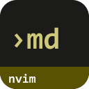
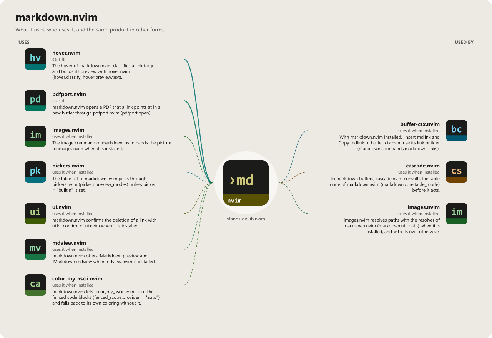

> **Beta stage — active development.** This repository is past its first shape and in
> active use, but the surface is not frozen: breaking changes are still possible. Pin a
> commit or tag if you depend on it.

# markdown.nvim

```
                         __       __
   ____ ___  ____ ______/ /______/ /___ _      ______
  / __ `__ \/ __ `/ ___/ //_/ __  / __ \ | /| / / __ \
 / / / / / / /_/ / /  / ,< / /_/ / /_/ / |/ |/ / / / /
/_/ /_/ /_/\__,_/_/  /_/|_|\__,_/\____/|__/|__/_/ /_/
            a self-contained markdown toolkit
```

[](LICENSE)
[](https://neovim.io)
[](https://www.lua.org)


[](https://github.com/WKDSteve/markdown.nvim/actions/workflows/ci.yml)
[](https://wkdsteve.github.io/wkd/p/markdown/)

> Part of the [wkd](https://wkdsteve.github.io/wkd/) family — see this plugin's [page](https://wkdsteve.github.io/wkd/p/markdown/) on the site.

A self-contained Markdown toolkit for Neovim, behind one `:Markdown` command.
Headings and folding, GFM tables, links and references, and a cursor-action
dispatcher that opens whatever is under the cursor — all of it FileType-scoped,
with no side effects on any buffer that is not Markdown.

---

## Around it

> **[cascade.nvim](https://github.com/WKDSteve/cascade.nvim)** — the list
> content inside the document: continue, renumber, rotate. markdown.nvim
> structures the document, cascade edits what is in it.
>
> **[hover.nvim](https://github.com/WKDSteve/hover.nvim)** — the host for
> the link preview. markdown.nvim contributes its link scanner and `#heading`
> previews; without it those simply do not exist.
>
> **[mdview.nvim](https://github.com/WKDSteve/mdview.nvim)** — renders the
> document outside the editor, for the moment you want to see it as a reader
> would.
>
> **[pdfport.nvim](https://github.com/WKDSteve/pdfport.nvim)** — the PDF
> half: exports the buffer, and renders a `.pdf` link target into a Neovim
> buffer instead of handing it to the system reader.
>
> **[images.nvim](https://github.com/WKDSteve/images.nvim)** — pasting and
> screenshotting images into the document, and drawing them in the preview.
>
> All of the above are soft: without them everything else works unchanged.
> [lib.nvim](https://github.com/WKDSteve/lib.nvim) is the one real
> dependency — see [Requirements](docs/installation.md#requirements).

---

## Documentation

Start at [docs/README.md](docs/README.md), which says what is where and which
question each page answers.

### The Basics

- [Requirements](docs/installation.md#requirements) — Neovim version, required plugins and CLI tools.
- [Installation](docs/installation.md) — a spec per plugin manager.
- [Quickstart](docs/quickstart.md) — the first thing to run after installing.

### Configuration

- [What you get with the defaults](docs/what-you-get.md) — the full command surface at a glance.
- [All options](docs/configuration.md) — every `setup()` option and its default, opening with the ready-to-paste snippets.
- [Config templates](docs/templates/README.md) — copy-paste `setup()` snippets: blockquote colors, feature subsets, picker backends, image preview.
- [Command reference](docs/commands.md) — `:Markdown`, subcommand by subcommand.
- [Keymaps](docs/keymaps.md) / [Bindings cheatsheet](docs/BINDINGS.md)

### The Rest

- [Features](docs/FEATURES/README.md) — one page per area: [headings](docs/FEATURES/HEADINGS.md), [tables](docs/FEATURES/TABLES.md), [links and references](docs/FEATURES/LINKS-AND-REFERENCES.md), [editing and handlers](docs/FEATURES/EDITING-AND-HANDLERS.md), [highlighting and UI](docs/FEATURES/HIGHLIGHTING-AND-UI.md), [integrations](docs/FEATURES/INTEGRATIONS.md).
- [Link hover preview](docs/hover.md) — the float that previews what a link or a bare path points at, and everything it can show.
- [Image captions](docs/image-captions.md) — implicit figures vs. an HTML `<figure>` vs. `@fig:` cross-references, and what each costs in the editor.
- [Fenced-block scope](docs/fenced-scope.md) — why a Markdown document inside another one needs its own scope.
- [Tables](docs/FEATURES/TABLES.md) — besides GFM: org, box-drawing, CSV and TSV tables (`table.formats`, `:Markdown table convert`), a picker over every table of a scope (`:Markdown table list`), and the native in-buffer renderer (`:Markdown render`).
- [Width-limited table wrapping](docs/table-wrap.md) — `:Markdown table format max=40`, the `:MDTable*` family, display-only truncation with a full-text popup (`:Markdown table truncate`), and a virtual grid that fits the window and re-lays out on resize (`:Markdown table render`).
- [Menu integration](docs/menu.md) — the context-aware entries shipped for nvzone/menu.
- [Architecture](docs/architecture.md) — source tree layout and module responsibilities.
- [Workflow](docs/WORKFLOW.md) — how the features combine while actually writing a document, rather than what each one does.
- [Health check](docs/health.md) — what `:checkhealth markdown` reports.
- [Contributing](docs/CONTRIBUTING.md) — ground rules, project layout, and how to add a handler or a command.
- [Feedback](https://github.com/WKDSteve/markdown.nvim/issues) — bugs, feature requests and usage questions; broader discussion in [Discussions](https://github.com/WKDSteve/markdown.nvim/discussions).

`:help markdown.nvim` is the same reference inside the editor.

---

## License

[](LICENSE)

markdown.nvim is released under the [MIT License](https://opensource.org/licenses/MIT).

<!-- connections:begin (written by the app-icons tool of the workshop; change integrations.json there, not this block) -->
## Connections



**Uses**

- [color_my_ascii.nvim](https://github.com/WKDSteve/color_my_ascii.nvim): markdown.nvim lets color_my_ascii.nvim color the fenced code blocks (`fenced_scope.provider = "auto"`) and falls back to its own coloring without it. ([picture](assets/graphs/pair/markdown.nvim--color_my_ascii.nvim.png))
- [hover.nvim](https://github.com/WKDSteve/hover.nvim): The hover of markdown.nvim classifies a link target and builds its preview with hover.nvim (`hover.classify`, `hover.preview.text`). ([picture](assets/graphs/pair/markdown.nvim--hover.nvim.png))
- [images.nvim](https://github.com/WKDSteve/images.nvim): The image command of markdown.nvim hands the picture to images.nvim when it is installed. ([picture](assets/graphs/pair/markdown.nvim--images.nvim.png))
- [mdview.nvim](https://github.com/WKDSteve/mdview.nvim): markdown.nvim offers `:Markdown preview` and `:Markdown mdview` when mdview.nvim is installed. ([picture](assets/graphs/pair/markdown.nvim--mdview.nvim.png))
- [pdfport.nvim](https://github.com/WKDSteve/pdfport.nvim): markdown.nvim opens a PDF that a link points at in a new buffer through pdfport.nvim (`pdfport.open`). ([picture](assets/graphs/pair/markdown.nvim--pdfport.nvim.png))
- [pickers.nvim](https://github.com/WKDSteve/pickers.nvim): The table list of markdown.nvim picks through pickers.nvim (`pickers.preview_modes`) unless `picker = "builtin"` is set. ([picture](assets/graphs/pair/markdown.nvim--pickers.nvim.png))
- [ui.nvim](https://github.com/WKDSteve/ui.nvim): markdown.nvim confirms the deletion of a link with `ui.kit.confirm` of ui.nvim when it is installed. ([picture](assets/graphs/pair/markdown.nvim--ui.nvim.png))
- [lib.nvim](https://github.com/WKDSteve/lib.nvim): the shared base of the plugins.

**Used by**

- [buffer-ctx.nvim](https://github.com/WKDSteve/buffer-ctx.nvim): With markdown.nvim installed, `:Insert mdlink` and `:Copy mdlink` of buffer-ctx.nvim use its link builder (`markdown.commands.markdown_links`). ([picture](assets/graphs/pair/buffer-ctx.nvim--markdown.nvim.png))
- [cascade.nvim](https://github.com/WKDSteve/cascade.nvim): In markdown buffers, cascade.nvim consults the table mode of markdown.nvim (`markdown.core.table_mode`) before it acts. ([picture](assets/graphs/pair/cascade.nvim--markdown.nvim.png))
- [images.nvim](https://github.com/WKDSteve/images.nvim): images.nvim resolves paths with the resolver of markdown.nvim (`markdown.util.path`) when it is installed, and with its own otherwise. ([picture](assets/graphs/pair/images.nvim--markdown.nvim.png))
<!-- connections:end -->
